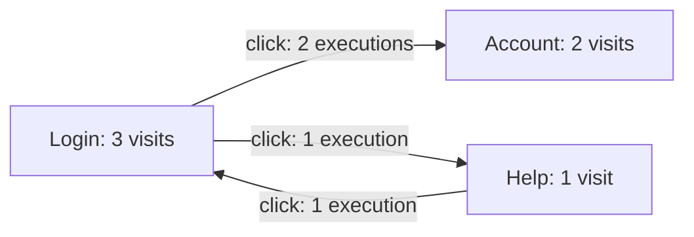

# Matching and derived models

## What matching means

A scripted test and an exploratory test can visit the same login page. Their observation IDs, widget IDs, screenshots, and actions may differ. Importing both traces makes them available together; a matching policy describes when their captured information should be considered equivalent.

The dashboard applies that policy to selected runs and builds matching groups. A group contains the original visits and explains the values used to compare them. Grouping expresses the user's chosen interpretation of the evidence.

For example, a page-address policy could group the login page from two runs even when the username differs. A policy that also compares the username would keep those visits separate. Neither policy changes the recorded actions, properties, screenshots, or oracle results.

## Try a policy

Select the runs to compare, choose a preset, and run the matching preview. Inspect a group to see its comparison values and contributing visits. Open an original visit to examine its evidence in the normal inspector.

The default **Page address and title** preset compares the captured `ui.url` and `ui.title` state properties. It removes the URL fragment and normalizes title whitespace, while preserving letter case. Different titles keep visits separate even when their addresses agree. Path and query parameters remain part of the comparison.

**Page address** compares only the address. **Page and widget structure** compares the address, title, and selected widget descriptions. Different tools can capture different widget trees or assign different meanings to properties, so this preset may keep their visits in separate groups.

The title presets require a captured string title. A missing or non-string title produces an explanation and leaves the visit unmatched. An empty captured title remains valid; two empty titles add no distinction between visits at the same address. For evidence that stores the actual page title under another state-property name, add that name to the title field's alternative `keys`. Names are tried in order: `["source.page_title", "ui.title"]` gives the captured source title precedence. Evidence containing only an address can use **Page address**.

Customize the JSON definition when the preset does not describe the intended comparison. Built-in presets and custom definitions use the same interpreter.

## Read the derived model

Switch from **Matching groups** to **Derived model** to see the matches as a graph. Each node contains the visits assigned to one matching group. A visit that could not be compared remains a separate node with its explanation, so its execution history stays visible.

For example, a scripted test might go from Login to Account. An exploratory test might go from Login to Help, return to Login, and then open Account. A policy that compares page addresses can produce this view:



Solid arrows summarize completed recorded executions. Executions are combined into one arrow when their source node, destination node, and exact action kind agree. The inspector retains each supporting execution, its parameters, and its original source and result observations. This grouping describes an action-kind summary; the actions may still have different targets or parameters.

An execution can produce a loop when both visits belong to the same node. Dashed arrows show consecutive observations whose connecting action is unknown. Selected, rejected, or incomplete executions remain available for inspection without inventing a completed transition.

Click a graph node or arrow, or select it from the corresponding list, to inspect its evidence. A path through merged nodes may combine edges from different runs; inspect its supporting executions before treating it as one recorded sequence.

**Model layout** offers **Force-directed**, **Hierarchical**, and **Circular** arrangements. Choose another layout or use **Reapply layout** to reposition the graph. **Fit model** fits the current graph window. Toggle state labels, action labels, and execution counts to control how much text appears.

**Highlight source** and **Highlight run** emphasize their supporting evidence. Use **Dim other evidence** to adjust the fading while keeping the whole model available. Existing node positions stay stable when highlighting, changing labels or dimming, toggling order links, or filtering evidence.

With a source or run chosen, **Show only selected source/run** limits the view to its contribution. A shared state remains when it contains a visit from that scope. The state counts, execution counts, and inspector lists then describe only the selected evidence. Other observations remain in the full model and its download. Highlighting without this checkbox keeps the complete model's counts and inspector lists.

The graph shows a bounded window. If selected evidence lies outside it, choose a state or link from the lists to load a new window with the chosen layout. Highlighting and filtering keep the current window in place.

These layout and display settings apply to the current derived view in browser memory. The matching rules, original evidence, and downloaded model retain their full scope.

A grouped node can contain observations with different screenshots and oracle results. Open the original visits to inspect those differences. Coverage remains attached to each original observation and target.

**Download model** saves the nodes, relationships, original references, matching definition, interpreter version, and input fingerprints. Screenshots and full source records stay in the original evidence folders.

## A small JSON language

The definition identifies its language version, gives the policy a name, and selects the comparison fields. Session data can make the same page address differ between runs. This example explicitly removes a named path parameter and query parameter while still comparing page titles:

```json
{
    "version": 1,
    "name": "Page address and title without session data",
    "state": [
        {
            "name": "address",
            "keys": ["ui.url"],
            "required": true,
            "transforms": [
                {
                    "op": "url",
                    "remove_path_parameters": ["jsessionid"],
                    "remove_query": ["session"],
                    "remove_fragment": true
                }
            ]
        },
        {
            "name": "title",
            "keys": ["ui.title"],
            "required": true,
            "transforms": [{ "op": "trim" }, { "op": "collapse_whitespace" }]
        }
    ],
    "capture": "same"
}
```

For comparison, `https://example.test/account;jsessionid=abc?session=temporary&mode=summary#top` becomes `https://example.test/account?mode=summary`. The full captured address remains in the original evidence.

Choose parameter names according to the application. Removing a parameter can combine visits that it previously distinguished. Names are exact and case-sensitive: `jsessionid` does not match `JSESSIONID` or `jsessionid_123`. The rule removes every named semicolon parameter from every path segment, including parameters without a value. Unrelated parameters keep their order and encoding.

Parameter names are percent-decoded once for comparison. Encoded semicolons are not treated as separators, and malformed encoded names remain unchanged. Query parameters and fragments change only when their separate options request it.

A field's `keys` are alternative property names, checked in order. The first property present in the captured record supplies its value. This allows a policy to read different names used by different producers. The `name` identifies that field in the comparison explanation.

Transforms normalize string values before comparison. Available operations trim text, collapse whitespace, convert text to lowercase, replace literal text, map chosen strings to common descriptions, and remove selected path parameters, query parameters, or fragments from absolute URLs. Replacement applies to every occurrence; an unmapped string keeps its original value. Values are compared exactly after normalization.

## Include or exclude widgets

Add a `widgets` section to compare widget descriptions. For example:

```json
"widgets": {
    "fields": [
        {"name": "role", "keys": ["ui.role"]},
        {"name": "label", "keys": ["ui.name", "ui.title"]}
    ],
    "exclude": [
        {"keys": ["ui.name", "ui.title"], "op": "equals", "value": "Current time"}
    ],
    "hierarchy": "flat",
    "order": "sort",
    "descendants": "exclude"
}
```

This fragment compares roles and labels, excludes a clock widget and its descendants, and ignores the order of the remaining descriptions. Two identical buttons still count twice.

Exclusion rules inspect the original property values. A widget is excluded when any rule matches. Rules can test whether a property is present, equals a JSON value, or contains selected text.

With `descendants: "keep"`, descendants of an excluded widget remain and attach to their nearest retained ancestor. `hierarchy: "tree"` compares those parent-child relationships; `"flat"` compares a collection of descriptions. `order: "preserve"` keeps captured order, while `"sort"` normalizes it.

Matching widget descriptions does not establish that the widgets are the same instance. A group can contain several widgets with the same description, and every original reference remains available. Widgets with no captured values for the selected fields do not receive correspondence links.

## Missing information and capture limits

A missing property differs from an explicit JSON `null`. A required field that is missing prevents that visit from joining a matching group and produces an explanation. An unsuitable value for a string transform also produces a diagnostic. An observation without usable comparison values is kept separate.

`capture: "same"` includes the recorded capture status in comparison. It distinguishes complete, filtered, and unavailable captures. Producers can have different capture scopes even when both report complete; users must check those scopes before interpreting a match. `"ignore"` deliberately leaves the status out of comparison.

When a policy compares widgets and the widget capture is unavailable, the observation remains separate. Known exclusions and normalization choices are part of the policy, rather than evidence that missing data was captured.

## Evidence remains traceable

The shared index scopes each record by its source and the record's run or observation where applicable. Identical IDs in unrelated sources remain separate. Each matching group retains references to its contributing original visits and widget descriptions.

A preview records the full definition and its SHA-256 fingerprint, the interpreter version, the source fingerprints, and the selected runs. These identify the inputs and rules that produced the result.

Evaluations retain their original targets. Grouping two visits does not mean that an oracle checked the same properties in both. Recorded action executions, observation-order links with unknown actions, and matching relationships keep their separate meanings.

Action-grouping rules, similarity algorithms, and reusable workspaces are tracked in [TODO.md](../TODO.md).

## Processing and ownership

Definitions are data interpreted by a fixed set of operations. Matching runs in a browser worker, supports cancellation, and uses bounded input and comparison sizes. It does not execute supplied JavaScript or contact captured URLs.

The dashboard repository owns this initial language and interpreter. A portable abstraction contract belongs in the specs project when other applications need to exchange or execute the same definitions.
