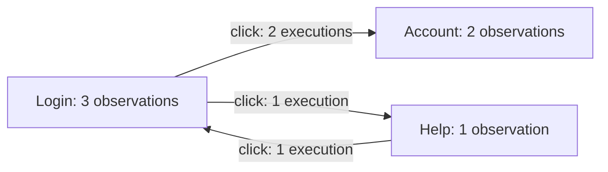

# Abstraction rules and abstract models

## How abstraction rules group observations

A scripted test and an exploratory test can observe the same login page. Their observation IDs, widget IDs, screenshots, and actions may differ. Importing both traces makes them available together; a set of abstraction rules describes when their captured information should be considered equivalent.

The dashboard applies those rules to selected runs and builds observation groups. A group contains the original observations and explains the values used to compare them. Grouping expresses the user's chosen interpretation of the evidence.

For example, a page-address policy could group the login page from two runs even when the username differs. A policy that also compares the username would keep those observations separate. Neither policy changes the recorded actions, properties, screenshots, or oracle results.

## Try abstraction rules

Select the runs to compare, choose a preset, and run the abstraction preview. Inspect a group to see its comparison values and contributing observations. Open an original observation to examine its evidence in the normal inspector.

The default **Page address and title** preset compares the captured `ui.url` and `ui.title` state properties. It removes the URL fragment and normalizes title whitespace, while preserving letter case. Different titles keep observations separate even when their addresses agree. Path and query parameters remain part of the comparison.

**Page address** compares only the address. **Page and widget structure** compares the address, title, and selected widget descriptions. Different tools can capture different widget trees or assign different meanings to properties, so this preset may keep their observations in separate groups.

The title presets require a captured string title. A missing or non-string title produces an explanation and leaves the observation unmatched. An empty captured title remains valid; two empty titles add no distinction between observations at the same address. For evidence that stores the actual page title under another state-property name, add that name to the title field's alternative `keys`. Names are tried in order: `["source.page_title", "ui.title"]` gives the captured source title precedence. Evidence containing only an address can use **Page address**.

Customize the JSON definition when the preset does not describe the intended comparison. Built-in presets and custom definitions use the same interpreter.

## Read the abstract model

Switch from **Observation groups** to **Abstract model** to see the matches as a graph. Each node contains the observations assigned to one observation group. An observation that could not be compared remains a separate node with its explanation, so its execution history stays visible.

For example, a scripted test might go from Login to Account. An exploratory test might go from Login to Help, return to Login, and then open Account. A policy that compares page addresses can produce this view:

Solid arrows summarize completed recorded executions. Executions are combined into one arrow when their source node, destination node, and exact action type agree. The inspector retains each supporting execution, its parameters, and its original source and result observations. This grouping describes an action-type summary; the actions may still have different targets or parameters.

An execution can produce a loop when both observations belong to the same node. Dashed arrows show consecutive observations whose connecting action is unknown. Selected, rejected, or incomplete executions remain available for inspection without inventing a completed transition.

Click a graph node or arrow, or select it from the corresponding list, to inspect its evidence. A path through merged nodes may combine edges from different runs; inspect its supporting executions before treating it as one recorded sequence.

**Model layout** offers **Force-directed**, **Hierarchical**, and **Circular** arrangements. Choose another layout or use **Reapply layout** to reposition the graph. **Fit model** fits the current graph window. Toggle state labels, action labels, and execution counts to control how much text appears.

**Highlight source** and **Highlight run** emphasize their supporting evidence. Use **Dim other evidence** to adjust the fading while keeping the whole model available. Existing node positions stay stable when highlighting, changing labels or dimming, toggling order links, or filtering evidence.

With a source or run chosen, **Show only selected source/run** limits the view to its contribution. A shared state remains when it contains an observation from that scope. The state counts, execution counts, and inspector lists then describe only the selected evidence. Other observations remain in the full model and its download. Highlighting without this checkbox keeps the complete model's counts and inspector lists.

The graph shows a bounded window. If selected evidence lies outside it, choose a state or link from the lists to load a new window with the chosen layout. Highlighting and filtering keep the current window in place.

These layout and display settings apply to the current abstract-model view in browser memory. The abstraction rules, original evidence, and downloaded model retain their full scope.

A grouped node can contain observations with different screenshots and oracle results. Open the original observations to inspect those differences. Coverage remains attached to each original observation and target.

**Download model** saves the nodes, relationships, original references, abstraction rules (JSON), interpreter version, and input fingerprints. Screenshots and full source records stay in the original evidence folders.

## A small JSON language

The dashboard uses the shared `testar-abstraction` package to interpret presets and custom rules. The [language reference](https://github.com/ferpasri/testar-abstraction/blob/main/docs/language.md) explains property selection, URL normalization, widget filtering, hierarchy, and capture-status comparison. The package repository also owns the abstraction conformance cases.

## Evidence remains traceable

The shared index scopes each record by its source and the record's run or observation where applicable. Identical IDs in unrelated sources remain separate. Each observation group retains references to its contributing original observations and widget descriptions.

A preview records the full definition and its SHA-256 fingerprint, the interpreter version, the source fingerprints, and the selected runs. These identify the inputs and rules that produced the result.

Oracle results retain their original targets. Grouping two observations does not mean that an oracle checked the same properties in both. Recorded action executions, observation-order links, and matching relationships keep their separate meanings.

Action-grouping rules, similarity algorithms, and reusable workspaces are tracked in [TODO.md](../TODO.md).

## Processing and ownership

Definitions are data interpreted by a fixed set of operations. Matching runs in a browser worker, supports cancellation, and uses bounded input and comparison sizes. It does not execute supplied JavaScript or contact captured URLs.

The `testar-abstraction` repository owns the shared language, interpreter, model construction, and abstraction conformance cases. This dashboard owns the worker lifecycle, rule editor, visual inspection, and rendering controls.
