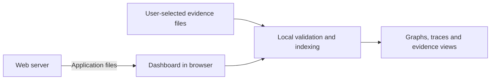

# Dashboard architecture

## Application and evidence flow

The dashboard is a browser application served over HTTPS or from a company-controlled deployment. A static web server delivers its HTML, JavaScript, styles, and bundled assets.

The browser performs the evidence-dependent work: reading files, checking records, building indexes, deriving relationships, and rendering results. Web Workers keep parsing and expensive computations away from interface interaction. The server may provide application-level services, but evidence processing follows the local-data boundary.

The same application build should support public hosting and self-hosting. A company can deploy a reviewed release inside its own environment.

## Responsibilities

| Part                  | Responsibility                                                                                                            |
| --------------------- | ------------------------------------------------------------------------------------------------------------------------- |
| Import and validation | Read selected files, identify supported formats, validate records and references, and verify artifact hashes.             |
| Evidence model        | Preserve imported records and expose queries over runs, observations, executions, widgets, properties, and check results. |
| Analysis              | Build indexes, calculate groups, and create derived relationships with traceable inputs.                                  |
| Interface             | Present graphs, ordered traces, screenshots, details, filters, and validation messages.                                   |
| Workspace             | Hold the user's imports, selections, annotations, grouping settings, and relationships.                                   |

The evidence and analysis logic should be separate from React components and graph-rendering objects so it can be tested independently.

## Shared input contract

A generic model consists of a manifest, JSONL event evidence, and referenced artifacts. The specs define its fields and meaning. The dashboard checks the declared schema version against the versions it supports, then validates records and their relationships.

Matching a schema version is the first compatibility check. Import also checks event identities, ordering, references, widget hierarchies, execution lifecycle, and artifact integrity. Validation messages identify the source file and relevant line or record. Shared conformance cases come from published specs releases, with the selected release recorded by development tooling.

Each import receives a local source identity. Record identities are interpreted within that source and their specified scope; identifiers from unrelated files must not accidentally connect records. Provenance, SUT information, and environment information remain available when users compare sources. Importing multiple sources does not itself establish that their states or widgets are equivalent.

## Original evidence and derived views

Original records describe what the producer captured. The dashboard preserves them while maintaining grouping rules, annotations, and user-created relationships separately.

A concrete trace shows ordered observations connected by completed action executions. Selection, submission, rejection, and incomplete executions retain their recorded meaning. Check results show their recorded targets and statuses. Capture limits and unavailable information remain visible to the user.

Users define abstractions through a small versioned DSL, initially represented as JSON. Default presets and custom definitions use the same pipeline: select evidence, filter widgets or properties, normalize changing data, build comparison representations, and group observations or actions. Each group retains links to its contributing evidence. See [abstraction and derived models](abstraction.md) for the language direction and traceability requirements.

Observed execution links, user-created associations, and algorithm-generated relationships have distinguishable meanings in the interface. Users can inspect the origin and reasoning behind a relationship.

Graph views should support filtering, trace highlighting, and inspecting a selected observation's widget hierarchy. Rendering can focus on the selected runs or groups while the original evidence remains available for detailed inspection.

## Supporting documents

SUT documentation, requirements, specifications, and BDD scenarios provide context for execution evidence. A document or a particular section can be associated with a run, observation, action execution, widget, or check result.

Document identity, provenance, section references, and relationship types need a shared contract when these associations become portable between tools. Changes to that contract belong in the specs repository. Dashboard-specific presentation and workspace settings belong here.

## Privacy and untrusted input

Selected evidence is read locally. Application dependencies, fonts, and other assets are bundled or served from the dashboard deployment. Imported URLs are treated as evidence; the dashboard must not automatically fetch them. Network requests, telemetry, and error reporting must not transmit imported evidence or evidence-derived content.

Hosted use still requires trust in the application code delivered by the server. Self-hosting a reviewed release gives companies control over that deployment. Privacy behavior should be verified with browser network tests.

Imported files are untrusted data. Controls include bounded file and record sizes, nesting and processing limits, safe relative artifact paths, artifact hash verification, and controlled image decoding. Archive support requires limits on entry count and actual expanded bytes, plus protection against unsafe paths and duplicate entries.

Labels and properties are rendered as text. Document previews require controlled renderers, with active content disabled and external resource loading restricted. A restrictive Content Security Policy provides additional protection. Format validity and matching hashes establish consistency, rather than trust in the producer.

The initial workspace lives in browser memory. Persistent browser storage can be introduced with explicit user control over saving and clearing evidence. Exported workspace files should explain whether they contain evidence copies or references that require the original files.

## Verification approach

Use shared specs conformance cases for generic input behavior. Add focused dashboard tests for multi-source identities, grouping membership, trace selection, validation messages, unsafe content, resource limits, and artifact handling.

Browser tests exercise local file import, graph/detail navigation, screenshots, check-result targets, and the privacy boundary. Representative larger traces measure import time, memory use, responsiveness, and graph behavior before selecting practical support limits.
