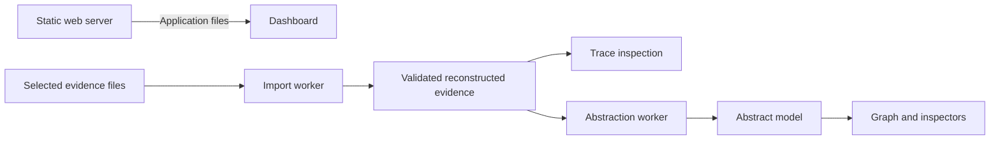

# Dashboard architecture

## Data flow

The browser reads and processes selected evidence locally. Workers separate import and model construction from interface interaction. The same production build supports hosted and self-hosted deployment.

## Responsibilities

| Component                           | Responsibility                                                                               |
| ----------------------------------- | -------------------------------------------------------------------------------------------- |
| Evidence importer and reconstructor | Read traces, validate records and lifecycle, verify artifacts, and retain source identities. |
| Shared abstraction package          | Interpret rules and build abstract models with supporting references.                        |
| Workers                             | Report progress, deliver completed results, and support cancellation by termination.         |
| React interface                     | Manage imports, selected runs, observations, rules, and in-memory workspace views.           |
| Cytoscape presentation              | Render bounded graph windows, layouts, selection, highlighting, and visual outcome markers.  |

`testar-abstraction` defines a structural input contract independent of the dashboard. The abstraction worker passes validated reconstructed records to the package. Source/run filtering and outcome-marker grouping change presentation while preserving the full constructed model.

## Evidence boundary

Record identities remain scoped to their imported source. Abstraction adds relationships and supporting references without modifying original records. Rules, model results, and interface selections live in browser memory until reload.

Runtime assets are bundled. Imported labels and URLs are treated as data; evidence processing does not fetch captured application URLs. Browser network tests verify this boundary. Detailed import, rendering, privacy, and resource behavior is defined in the [dashboard specification](SPEC.md).

The [TESTAR Evidence specs](https://github.com/ferpasri/testar-evidence-specs) own the input contract. The [abstraction package](https://github.com/ferpasri/testar-abstraction) owns language semantics and its conformance cases. [TODO](../TODO.md) tracks additional workspace and document-association capabilities.
